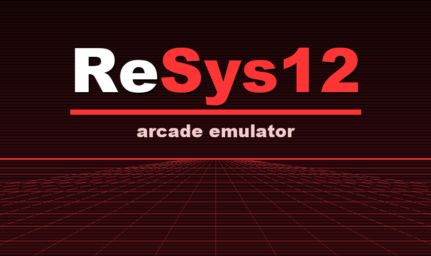

<p align="center">
  
</p>

<h1 align="center">ReSys12</h1>

<p align="center">
  <b>Namco System 12 arcade emulator for PlayStation Vita</b><br>
  pcsx_rearmed based &middot; R3000A dynarec for ARMv7 &middot; NEON GPU rasterizer &middot; C352 sound<br>
  <a href="https://www.patreon.com/Reyanon">Support on Patreon</a> or <a href="https://ko-fi.com/reyanon">Ko-Fi</a>
</p>

---

## Table of Contents

1. [Introduction](#1-introduction)
2. [Highlights](#2-highlights)
3. [Supported Games](#3-supported-games)
4. [Download](#4-download)
5. [Installation](#5-installation)
6. [Usage](#6-usage)
7. [Building from Source](#7-building-from-source)
8. [Project Layout](#8-project-layout)
9. [Accuracy and Testing](#9-accuracy-and-testing)
10. [License and Credits](#10-license-and-credits)
11. [Support](#11-support)

---

## 1. Introduction

ReSys12 is an emulator for the Namco System 12 arcade board, the PlayStation-based hardware behind
Tekken Tag Tournament, Tekken 3, Soul Calibur, Ehrgeiz, Point Blank 2 and others. The CPU, GTE and GPU come from
[pcsx_rearmed](https://github.com/notaz/pcsx_rearmed); the board itself (ROM banking, protection, H8/3002 sub CPU,
C352 sound, EEPROM, JVS I/O) is ported from [MAME](https://www.mamedev.org/).

System 12 is a PlayStation with twice the CPU clock (R3000A at 48 MHz), up to 4 MB of RAM, banked ROM
instead of a CD drive, and a separate H8/3002 with a 32-voice C352 for sound. The first target is Tekken Tag
Tournament at a locked 60 fps on a PS Vita at 444 MHz, without frame skipping. Every frame is emulated and drawn.

Board accuracy is kept where the player can see or hear it. Timing details that do not change what is on
screen are simplified when that buys speed.

## 2. Highlights

**Core**
- ari64 R3000A dynamic recompiler for ARMv7 from pcsx_rearmed, with code cache warm-up across runs and
  smaller VM domain syncs.
- NEON GTE and the gpu_neon software rasterizer running on its own core, fed by an asynchronous command queue.
- Idle loop skipping for the main CPU and the H8/3002 (polling, timeout and wait loops), so waiting CPUs do not
  burn host time.
- H8/3002 interpreter with table-driven decoding; C352 on its own core with a lock-free ring buffer to the audio output.
- KC0xx protection and ROM DMA ported from MAME, with the DMA source fixes needed by Tekken Tag Tournament.

**Rendering (vitaGL)**
- The emulated GPU writes into GPU-visible texture memory; only changed VRAM rows are converted (15, 8 and 4 bpp).
- Interlaced 480-line games are drawn one field at a time.
- Vertical games (Tenkomori Shooting) are rotated on the GPU.

**Frontend**
- Game list with Buttons / Gun / Wheel-Lever tabs and a Playable / All / Favorites filter.
- Save states (10 slots plus quick save / load), button mapping with turbo and combo keys, duplicate key warnings.
- Gun games: aim with an analog stick, adjustable sensitivity and crosshair. Driving games: wheel on a stick,
  gas and brake on the shoulder buttons.
- Display options: aspect ratio, filter, border color or user artwork, frame rate counter.
- Per-game settings: save the current display and control settings for one game only.

## 3. Supported Games

Set names are the MAME set names. ROMs must match the MAME romset (see [ROM sets](#rom-sets)); clone sets read missing
files from the parent zip. System 12 has no BIOS.

**Status**: *Playable*, *Partial* or *Not working* on a PS Vita at 444 MHz. *Partial* sets run, but a known problem
remains (listed in the notes). Full speed is 60 fps (59.94 Hz).

| Game | Sets (parent first) | Year | Status | Notes |
|---|---|---|---|---|
| Tekken Tag Tournament | `tektagt`, `tektagtc1a`, `tektagtub`, `tektagtuc1`, `tektagtjc1` | 1999 | Playable | ~60 fps, short drops in a few stages |
| Tekken 3 | `tekken3`, `tekken3a`, `tekken3b`, `tekken3c`, `tekken3d`, `tekken3ua`, `tekken3ud`, `tekken3ja`, `tekken3jd`, `tekken3je1` | 1997 | Playable | |
| Soul Calibur | `soulclbr`, `soulclbrab`, `soulclbrac`, `soulclbrub`, `soulclbruc`, `soulclbrja2`, `soulclbrjb`, `soulclbrjc` | 1998 | Playable | |
| Ehrgeiz | `ehrgeiz`, `ehrgeizua`, `ehrgeizja` | 1998 | Partial | ~53 fps in fights |
| Fighting Layer | `fgtlayer`, `fgtlayerja` | 1998 | Playable | |
| Shin Nihon Pro Wrestling Toukon Retsuden 3 Arcade Edition | `toukon3` | 1997 | Playable | ~57 fps in matches |
| Libero Grande | `lbgrande` | 1997 | Playable | the game runs at 30 fps |
| Super World Stadium '98 | `sws98` | 1998 | Playable | |
| Super World Stadium '99 | `sws99` | 1999 | Playable | |
| Mr. Driller | `mrdrillr`, `mrdrillrja2` | 1999 | Playable | |
| Aqua Rush | `aquarush` | 1999 | Playable | |
| Tenkomori Shooting | `tenkomor`, `tenkomorja1` | 1998 | Playable | vertical screen |
| Paca Paca Passion | `pacapp` | 1998 | Partial | falling notes may be drawn twice |
| Paca Paca Passion 2 | `pacapp2` | 1999 | Partial | as above |
| Paca Paca Passion Special | `pacappsp` | 1999 | Partial | as above |
| Derby Quiz My Dream Horse | `mdhorse` | 1998 | Playable | |
| Kaiun Quiz | `kaiunqz` | 1999 | Playable | |
| Point Blank 2 / Gunbarl | `ptblank2`, `gunbarl` | 1999 | Partial | gun on an analog stick; may stop during play |
| Ghoul Panic / Oh! Bakyuuun | `ghlpanic`, `ohbakyuun` | 1999 | Playable | gun on an analog stick |
| Golgo 13 | `golgo13` | 1999 | Partial | the board tests its ROMs for a while after power-on |
| Golgo 13 Kiseki no Dandou | `g13knd` | 2000 | Partial | as above |
| Techno Drive | `technodr` | 1998 | Playable | wheel on an analog stick |
| Attack Pla Rail | `aplarail` | 1998 | Playable | lever on an analog stick |
| Kart Duel | `kartduel`, `kartduelja` | 2000 | Partial | no link play |
| Tekken Tag Tournament (Japan) | `tektagtja3`, `tektagtjb` | 1999 | Not working | bad dumps, also not working in MAME |
| Super World Stadium 2000 / 2001 | `sws2000`, `sws2001` | 2000 | Not working | also not working in MAME |
| Um Jammer Lammy NOW!, Quest for Fame, Truck Kyosokyoku | `ujlnow`, `questff`, `truckk` | 1999 | Not working | CD-XA board, not emulated |

## 4. Download

Prebuilt binaries are published on the [Releases](../../releases) page:

| File | Platform | Contents |
|---|---|---|
| `ReSys12_vX.Y.Z_vita.zip` | PS Vita / PS TV | `ReSys12_vX.Y.Z_vita.vpk` and an empty `data/resys12/roms/` folder |

The releases contain the emulator only. **No ROMs or game artwork are included or provided.**
You must supply ROM images of games you own.

## 5. Installation

### PS Vita

Requirements:
- A PS Vita or PS TV that can install homebrew VPK files with [VitaShell](https://github.com/TheOfficialFloW/VitaShell).
- The runtime shader compiler `ur0:data/external/libshacccg.suprx`. ReSys12 compiles its GPU shaders on the
  device, and games cannot be drawn without it. If it is missing, extract it with
  [ShaRKBR33D](https://github.com/Rinnegatamante/ShaRKBR33D) or copy it from another homebrew setup guide.

**Install the VPK**

1. Extract `ReSys12_vX.Y.Z_vita.zip` on your PC.
2. Start VitaShell on the Vita and connect it to the PC:
   - USB: press **SELECT** in VitaShell, connect the cable, and the memory card appears as a drive; or
   - FTP: press **SELECT** in VitaShell and connect an FTP client to the address shown on screen.
3. Copy `ReSys12_vX.Y.Z_vita.vpk` to `ux0:` (any folder, for example `ux0:downloads/`).
4. Disconnect, open the folder in VitaShell, select the `.vpk` and press **X** to install.
   Accept the extended permissions prompt. A **ReSys12** bubble appears on the home screen (title ID `RSYS00012`).
5. The `.vpk` file can be deleted after installation.

**Add ROMs**

1. Copy the `data` folder from the zip to the root of `ux0:` so that the empty folder is
   `ux0:data/resys12/roms/` (ReSys12 also creates it on first launch).
2. Put your ROM zips in that folder, unchanged and not extracted, for example
   `ux0:data/resys12/roms/tektagt.zip`.
3. Start ReSys12. The game list shows every known set, grouped by controller type.

The first start of a game unpacks its ROMs into `ux0:data/resys12/cache/`, which takes a few seconds. Later
starts load the cache directly.

### ROM sets

- ROMs must be **MAME 0.260** compatible sets (romsets from MAME 0.260 or newer also work; the few sets whose
  files changed after 0.260 are recognized in both forms).
- Keep each set as one zip named after the set, for example `tektagt.zip`. Do not rename or extract them.
  Files inside the zip are matched by CRC32, so their names do not matter.
- Clone sets (for example `tektagtub`) read missing files from the parent zip (`tektagt.zip`), so keep the
  parent in the same folder, or use non-merged sets.
- No BIOS zip is needed. CHD images are not used.
- The *Playable* list shows only sets whose ROM zip was found; press SELECT in the list to show all supported sets.

### Optional files

| What | Path |
|---|---|
| Border artwork | `ux0:data/resys12/artwork/<set>.png` (the parent set name is tried next) |

Files written by the emulator:

| What | Path |
|---|---|
| Settings and favorites | `ux0:data/resys12/settings.cfg`, `ux0:data/resys12/favorites.cfg` |
| Per-game settings | `ux0:data/resys12/cfg/<set>.cfg` |
| EEPROM (test mode settings, records) | `ux0:data/resys12/nvram/<set>.eep` |
| Save states | `ux0:data/resys12/state/<set>_<slot>.st` |
| ROM cache | `ux0:data/resys12/cache/` (safe to delete) |

## 6. Usage

**Game list**

| Action | Buttons |
|---|---|
| Start the selected game | Cross (or Circle, see Controls) |
| Change tab (Buttons / Gun / Wheel-Lever) | L / R |
| Page up / down | Left / Right |
| Add / remove favorite | Square |
| Filter: Playable / All / Favorites | SELECT |
| Options (Display, Controls) | START |
| About | Triangle |

Options opened from the game list edit the global settings.

**In game**

| Action | Buttons |
|---|---|
| Lever | D-pad (or left stick, see Controls) |
| Buttons 1-4 | Square, Triangle, Cross, Circle (Tekken: left punch, right punch, left kick, right kick) |
| Buttons 5-6 | R, L (Tekken Tag Tournament: R = tag) |
| Coin / Start | SELECT / START |
| Open the in-game menu | SELECT + START |
| Quick save / quick load | SELECT + L / SELECT + R |
| Exit | L + R + SELECT + START |

The in-game menu provides: Resume, Reset, Test mode (service DIP switch), Save states (10 slots), Display
(frame rate counter, aspect ratio, filter, border), Controls (button mapping, turbo, combo keys, analog stick,
gun / wheel / lever settings for the games that use them), per-game settings and game selection.

**Turbo.** Pick one *Turbo key* and the game button it fires (*Turbo button*), plus the speed.
While the turbo key is held, that game button fires repeatedly.

**Combo keys.** A Vita button can press two game buttons at once (for example the Tekken tag throw).

**Gun games.** The aim follows the analog stick (stick position or stick moves the aim), R is the trigger. Golgo 13
uses L as the scope sensor.

**Driving games.** The wheel or lever follows an analog stick (the d-pad also works), R is gas and L is brake.

The last played game is remembered and selected on the next launch. EEPROM data is written shortly after the
game changes it and again on exit.

## 7. Building from Source

Builds are done on Linux or WSL (Ubuntu 24.04 is used for development).

### Prerequisites

```bash
sudo apt install -y build-essential cmake ninja-build git python3 zlib1g-dev
```

- PS Vita: [VitaSDK](https://vitasdk.org/) with `vitashark`, `libpng` and `zlib` (`vdpm` install-all), `VITASDK` set.
- [vitaGL](https://github.com/Rinnegatamante/vitaGL) built and installed into VitaSDK.

### PS Vita

```bash
bash tools/build.sh vita
# output: build-vita/resys12.vpk, build-vita/eboot.bin
```

### Desktop test harness

A headless harness runs the System 12 core on a PC and prints per-frame video and audio hashes. It is used as the
reference for every optimization.

```bash
bash tools/build.sh pc
./build-pc/harness --roms path/to/roms --game tektagt --frames 3600 --checkpoint 600
```

An ARM build of the harness (`tools/build_arm_harness.sh`, run under `qemu-arm`) exercises the recompiler and
the NEON code with the same hashes, and creates save states in the Vita layout.

## 8. Project Layout

```
src/psx/       pcsx_rearmed subset: R3000A, ari64 recompiler, GTE, gpulib, gpu_neon, plus the System 12 shim
src/s12/       System 12 board: memory map, KC0xx protection, ROM DMA, EEPROM, RTC, JVS I/O, save states
src/h8/        H8/3002 sound / I/O CPU
src/sound/     C352
src/romload/   MAME set tables, zip reader, ROM cache
src/sys/       Vita heap and JIT memory
vita/          PS Vita port: frontend, video output (vitaGL), platform code, LiveArea assets
tools/         Build scripts, desktop harness, table generators, bench and app art tools
```

## 9. Accuracy and Testing

- Every performance change is checked against the desktop harness: frame and audio hashes are compared
  before and after over thousands of frames on a set of reference games.
- Changes that alter the hashes on purpose (idle-loop skipping, relaxed synchronization) are checked with save
  states and recorded input against reference screenshots, so that the game reaches the same scenes with the same
  picture and sound.
- The recompiler is compared against the interpreter in the ARM harness.
- Sound output is recorded on the device and compared with MAME.

## 10. License and Credits

**License.** ReSys12 is distributed under the [GNU General Public License, version 3](LICENSE).
- The pcsx_rearmed code and the ReSys12 code are GPL-2.0-or-later (pcsx_rearmed's license text is in `src/psx/COPYING`).
- The MAME parts (System 12 board, H8/3002, C352) are BSD-3-Clause.
- vitaGL and vitaShaRK, linked into the Vita build, are LGPL-3.0, so the combined program and the release packages
  are distributed under GPL-3.0.

The original copyright headers are kept in all imported sources.

**Credits**
- [pcsx_rearmed](https://github.com/notaz/pcsx_rearmed) (notaz, Ari64 and contributors): R3000A, ari64 recompiler,
  GTE, gpulib and gpu_neon.
- [MAME](https://www.mamedev.org/) developers: System 12 board, H8/3002, C352, AT28C16, ROM definitions and
  hardware research.
- [VitaSDK](https://vitasdk.org/), [vitaGL](https://github.com/Rinnegatamante/vitaGL) and
  [vitaShaRK](https://github.com/Rinnegatamante/vitaShaRK) (Rinnegatamante).
- [JUnzip](https://github.com/jokkebk/JUnzip), [zlib](https://zlib.net/), [libpng](https://github.com/pnggroup/libpng).

**Trademarks.** Namco, System 12 and all game titles are trademarks of their respective owners. This project is not
affiliated with or endorsed by Bandai Namco or any rights holder. No ROM images, game graphics or logos are
included in this repository or in the release packages.

## 11. Support

ReSys12 is free software. If you want to support its development, you can do so on
[Patreon](https://www.patreon.com/Reyanon) or [Ko-Fi](https://ko-fi.com/reyanon). Support is for the emulator work only.

**ROMs are never provided, to anyone, including supporters.** Do not ask for them.
